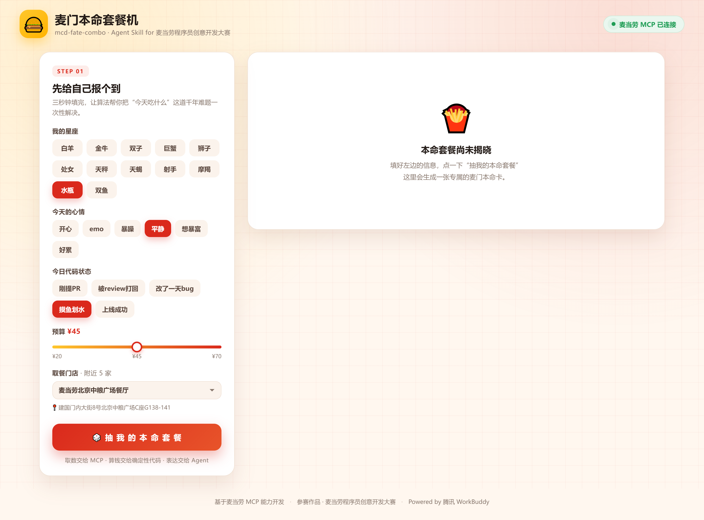
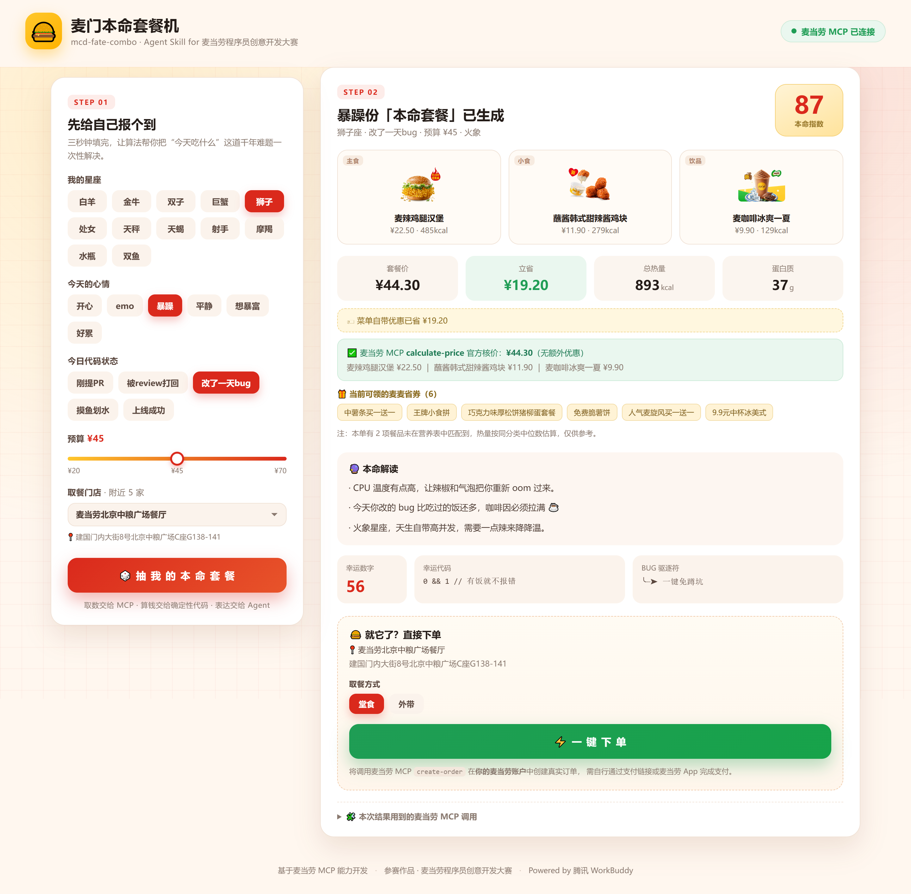
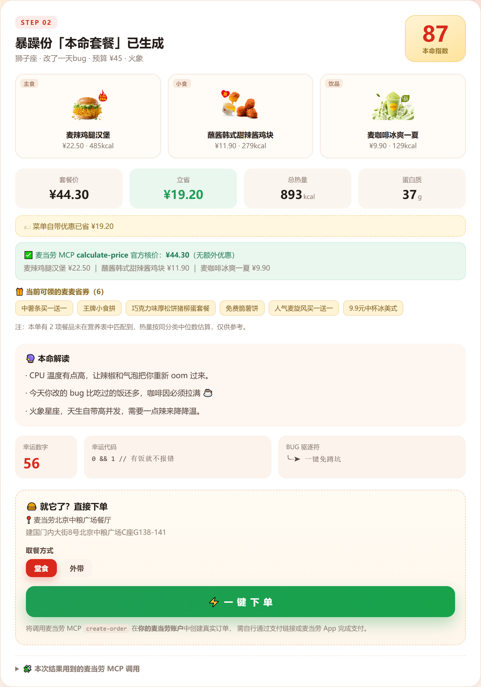
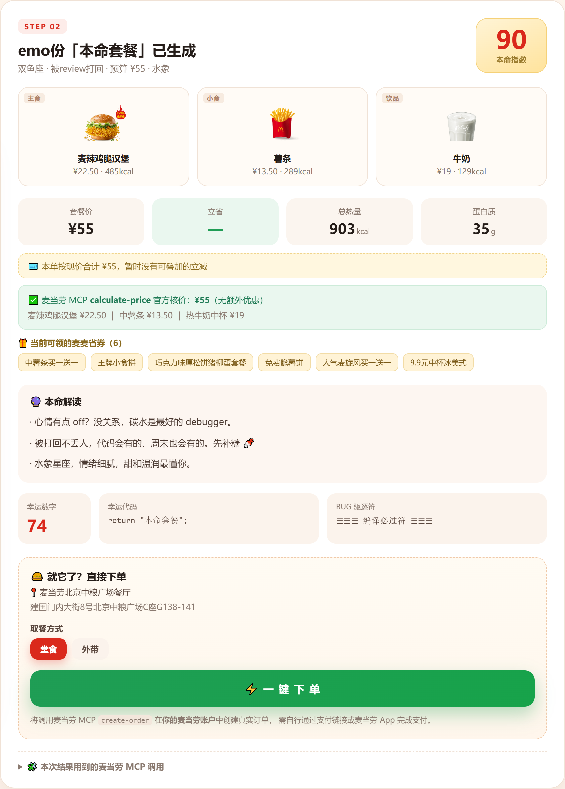
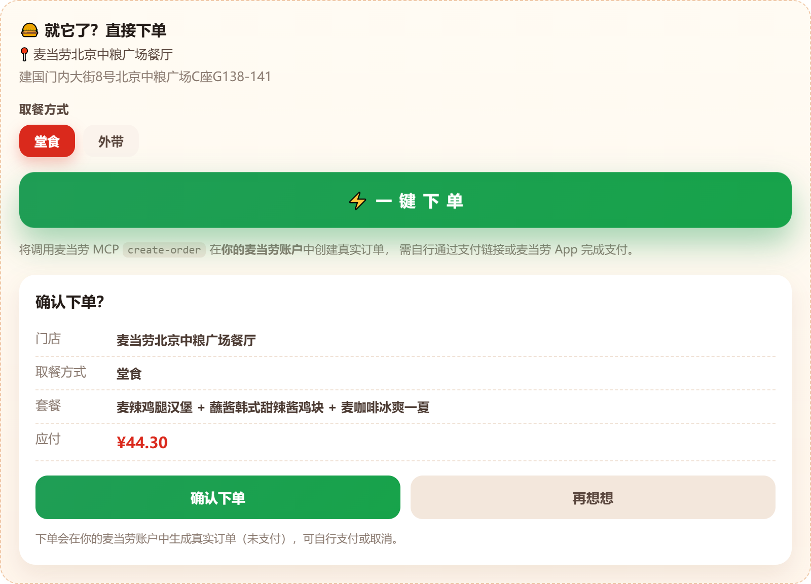

# 🍔 麦门本命套餐机 · mcd-fate-combo

> 「今天吃什么」是当代打工人每天最难的算法题。
> 这个 Skill 把它变成一道**有答案的题**——输入你的星座、心情、代码状态和预算，
> 用麦当劳 MCP 的真实菜单数据 + 确定性组合优化算法，算出一份专属于你的**本命套餐**，
> 再附上一段带程序员梗的运势解读。


**麦门本命套餐机页面效果1**


**麦门本命套餐机页面效果2**


**麦门本命套餐机页面效果3**


**麦门本命套餐机页面效果4**


**麦门本命套餐机页面效果5**

---

## 一、它解决什么问题

中午 12 点，你盯着麦当劳 App 的菜单，陷入了经典的 **O(菜单数量 × 券种数量)** 选择困难：

- 想吃巨无霸，但今天心情 emo，是不是该来点甜的？
- 预算 32 块，1+1 随心配和满 30 减 5 到底哪个划算？
- 算了半天，最后随便点了一个，吃完又觉得亏了。

**麦门本命套餐机** 把这件事变成三秒钟的事：

1. 选星座 / 心情 / 代码状态 / 预算
2. 点一下「抽我的本命套餐」
3. 拿到一份带热量、蛋白质、券后价和「本命指数」的套餐卡

它不只是推荐，还**帮你把券也叠好了**。

---

## 二、目标用户

- **选择困难症程序员**：每天纠结中午吃什么，需要有人替他拍板；
- **减脂 / 控热量的打工人**：想知道这一顿多少 kcal、多少蛋白质；
- **精打细算的学生党**：想知道怎么叠券最便宜；
- **喜欢仪式感的人**：想给平凡的一顿午饭加一点"玄学"和乐趣。

---

## 三、核心设计：取数 / 算钱 / 表达 三分离

这是整个 Skill 最重要的一条工程决策：

| 环节 | 交给谁 | 为什么 |
| --- | --- | --- |
| **取数**（菜单、营养、券） | 麦当劳 MCP | 数据以官方为准，实时、可核验 |
| **算钱**（组合、比价、叠券） | 确定性代码（纯标准库） | 价格必须可复现、可核验，绝不让大模型心算 |
| **表达**（运势文案、卡片） | Agent / 模板 | 保证稳定、好读、每次都对 |

> 一句话：**不让大模型算钱。** 大模型擅长表达，不擅长精确算术。

---

## 四、安装与运行

### 1. 准备 MCP Token（免费）

打开 <https://open.mcd.cn/mcp>，手机号登录 → 控制台 → 激活，复制 MCP Token。

### 2. 配置 MCP

两种方式任选其一：

**方式 A · `.env` 文件（推荐，本地开发）**

在项目根目录建一个 `.env`（已被 `.gitignore` 忽略，不会入库）：

```
MCD_MCP_TOKEN=你的Token
MCD_CITY=北京市
```

**方式 B · 环境变量 / MCP Client 配置**

把 `mcp-config.example.json` 贴进你的 MCP Client（腾讯 WorkBuddy / Cursor / Cherry Studio 等），
并将 `${MCD_MCP_TOKEN}` 替换为真实 Token：

```json
{
  "mcpServers": {
    "mcd-mcp": {
      "type": "streamablehttp",
      "url": "https://mcp.mcd.cn",
      "headers": { "Authorization": "Bearer ${MCD_MCP_TOKEN}" }
    }
  }
}
```

### 3. 启动本地服务（零依赖，无需 npm install）

```bash
node server.js
# → http://localhost:8788
```

> - 配置 Token 后会**真实调用麦当劳 MCP**：拉取附近门店、在售菜单（含现价与商品图）、
>   营养数据、可领券，并在出结果时用官方 `calculate-price` 核价；
> - 未配置 Token 或调用失败时，自动回退 `data/mcd-menu.json` **MCP 数据快照**，
>   保证评审无需 Token 也能跑通。
> - 页面右上角的连接状态徽章会标明当前是「实时」还是「快照」模式。

---

## 五、使用示例（真实 MCP 数据实测）

**输入**

```
星座：狮子座 ｜ 心情：暴躁 ｜ 代码状态：改了一天bug ｜ 预算：¥45
```

**输出**

```
本命套餐：麦辣鸡腿汉堡 + 蘸酱韩式甜辣酱鸡块 + 麦咖啡冰爽一夏
本命指数：87
套餐价：¥44.30（菜单自带优惠已省 ¥19.20）
总热量：893 kcal ｜ 蛋白质：37 g

✅ 麦当劳 MCP calculate-price 官方核价：¥44.30
   麦辣鸡腿汉堡 ¥22.50 ｜ 蘸酱韩式甜辣酱鸡块 ¥11.90 ｜ 麦咖啡冰爽一夏 ¥9.90

本命解读：
· CPU 温度有点高，让辣椒和气泡把你重新 oom 过来。
· 今天你改的 bug 比吃过的饭还多，咖啡因必须拉满 ☕
· 火象星座，天生自带高并发，需要一点辣来降降温。
```

换一种状态，结果会明显不同（同一预算 ¥55）：

| 心情 | 推荐 |
| --- | --- |
| 暴躁 | 麦辣鸡腿汉堡 + 韩式甜辣酱鸡块8块 + 麦咖啡美式 |
| 平静 | 双层深海鳕鱼堡 + 那么大鸡排 + 浓缩咖啡 |
| 想暴富 | 芝士安格斯厚牛堡 + 那么大鸡排 + 鲜萃咖啡 |
| 开心 | 巨无霸 + 韩式甜辣酱鸡块8块 + 鲜萃咖啡 |

---

## 五点五、确定好了？一键下单

页面会把**附近 5 家麦当劳门店**列出来，可自由切换（切换后菜单和价格都会跟着变）。

套餐确定后，点「⚡ 一键下单」会走完整的真实下单链路：

```
calculate-price → 拿到官方金额 + 取餐方式（堂食 / 外带，takeWayList）
      ↓
create-order   → 在你的麦当劳账户中创建真实订单（未支付）
      ↓
返回订单号 + 支付链接 → 去麦当劳 App 或扫码完成支付
```

> ⚠️ 这是**真实下单**：会在你的麦当劳账户中生成未支付订单，可自行支付或在 App 中取消。
> 界面做了二次确认，不会误触。

---

## 六、技术亮点

1. **确定性算法**：同一个人、同一天，永远得到同一份套餐（FNV-1a 散列做种子），结果可复现；
2. **组合优化比价**：穷举满减券 / 单品券 / 1+1 随心配三类券，给出券后最低价；
3. **营养可解释**：每份套餐都给出总热量与蛋白质，基于 `list-nutrition-foods` 官方数据；
4. **闭环到下单**：不只推荐——定位门店、官方核价、`create-order` 真实下单，一条链路走到底；
5. **零依赖**：后端仅用 Node 内置模块，前端原生 JS，克隆即可跑。

---

## 七、目录结构

```
mcd-fate-combo/
├─ server.js                 # 零依赖本地服务（静态 + /api/divine + /api/stores + /api/order）
├─ lib/fate.js               # 本命套餐核心算法（纯标准库）
├─ lib/mcp.js                # 麦当劳 MCP 客户端（Streamable HTTP + JSON-RPC 2.0，纯标准库）
├─ lib/mcp-source.js         # 数据适配层（菜单 / 营养 / 券 / 门店）
├─ lib/order.js              # 下单封装（calculate-price → create-order）
├─ public/                   # 原生前端 SPA
│  ├─ index.html
│  ├─ css/style.css
│  └─ js/app.js
├─ tools/                    # 开发调试脚本（探针 / 截图 / 矩阵调参）
├─ shots/                    # 界面截图
├─ data/mcd-menu.json        # 麦当劳 MCP 数据快照
├─ mcp-config.example.json   # MCP 配置示例（环境变量占位）
├─ MCP_INTEGRATION.md        # MCP 调用说明
├─ CONTEST_DECLARATION.md    # 参赛声明
└─ workbuddy.md              # WorkBuddy 开发过程存档
```

---

## 八、License

MIT
